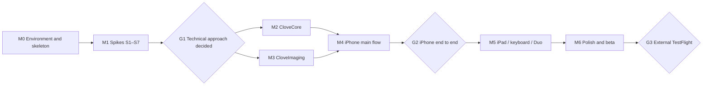

# Clove launch development plan

Status: draft, with M1/G1 decided by the product owner on 2026-11-09. Based on the [PRD](PRD.en.md) (P0-01 through P0-15). This document breaks the work into tasks with dependencies and acceptance criteria. The [approved G1 record](decisions/G1-technical-approach.md) fixes the technical approach; remaining device checks stay open.

## How development works

All development is done by agents. The product owner handles real-device verification, the Apple account and signing, and decisions at each gate. UI visuals are designed by someone else. Engineering implements behavior with system components first and swaps in the visual design when it arrives.

[AGENT-WORKFLOW.md](AGENT-WORKFLOW.md) describes the roles, the issue-to-PR handoff, the worker report format, and who merges what.

### Agent rules

- One task, one issue, one branch, one PR. Issue and PR titles start with the task ID, for example `[C3] XMP codec`.
- Every PR includes tests and merges only after verification passes: the `verify` check of the GitHub Actions workflow runs the whole gate (build, unit and package tests, the simulator smoke test and UI flows) on a hosted macOS runner after merging the latest `main`. Workers run `mise run check` locally; the supervisor merges on a green run against the current `main`.
- Stay within the task's scope. Open an issue for anything outside it instead of fixing it in passing.
- A spike's output is a report at `docs/spikes/Sx-name.md` (what was tested, data, conclusion, recommendation) plus reusable verification code. Spikes do not ship product features.
- Where a decision is needed, list the options and a recommendation in the report or PR. The product owner decides at the gate.
- The PRD wins any conflict. If the PRD looks infeasible, raise it in a report. Do not change scope unilaterally.
- `AGENTS.md` at the repository root (produced by T0.2) records code conventions, directory layout, and how to run tests. Every agent reads it before starting.

### Real-device verification

Agents cannot operate physical devices. Tasks marked "Device" follow this loop:

1. The agent builds the verification logic into **Clove Lab**, a debug app that is a separate target in the same repository.
2. The release script on the Mac mini uploads Clove Lab to TestFlight for internal testing, which needs no review.
3. The product owner installs it on the device and follows the task's checklist. Clove Lab writes measurements to a JSON report, saved into the tested folder or sent through the share sheet.
4. The report goes back to the agent for analysis and into the spike report.

Test devices: iPhone 17 Pro Max, iPad Pro, and iPhone Duo. The owner's camera media is a CFexpress Type A card in a USB reader, which iOS treats as an external drive like an SSD. SD readers remain a supported-media example, not the owner's workflow. Removable media is not on the MVP critical path; external-media checks are non-blocking and run when convenient, using the CFexpress reader first.

## Prerequisites (done 2026-11-08)

- **Build host.** A Mac mini with Xcode 27.1 and Swift 6.4 is linked to T3 as the agent environment. The repository and worker checkouts live on its T7 external SSD. Details are in [AGENT-WORKFLOW.md](AGENT-WORKFLOW.md#environment).
- **Bundle IDs and app records.** `com.mimiqdev.clove` (Clove) and `com.mimiqdev.clove.lab` (Clove Lab) are registered, each with an App Store provisioning profile and an App Store Connect app record. Clove Lab is used only for internal TestFlight testing, through the `Clove Lab Internal` group.
- **App Store Connect API key and distribution certificate** stay on the Mac mini in `~/.config/apple/`. They are referenced from gitignored local config and never committed or stored in GitHub.

## Technical baseline

- Native iOS and iPadOS app, minimum iOS 18, Swift 6 with strict concurrency checking.
- SwiftUI first. Wrap UIKit where performance or gestures demand it: the grid (`UICollectionView`), focus-check zoom (`UIScrollView`), and the custom swipe-distance rating gesture.
- Generate the Xcode project from an XcodeGen `project.yml`. Do not commit `.xcodeproj`, so parallel agents never conflict in `project.pbxproj`.
- No third-party dependencies by default. [G1](decisions/G1-technical-approach.md#3-recommended-by-the-spikes-accepted) adopts a validated, preserving custom XMP editor; neither ImageIO whole-packet writing nor the default Adobe SDK is used.
- Layers:

| Module | Contents | Depends on |
| --- | --- | --- |
| `CloveCore` (Swift package) | Domain model, scanning and pairing, XMP codec, write queue, undo, Move rejects, grouping algorithm, settings, Recents | Foundation (XMP follows [G1](decisions/G1-technical-approach.md)) |
| `CloveImaging` (Swift package) | Preview extraction and caching, full RAW decoding, image feature computation | ImageIO, Core Image, Vision |
| `Clove` (app) | UI, gestures, scene state | Both packages |
| `CloveLabKit` (Swift package) | Topic-named lab probes and report tooling | Foundation, ImageIO, Core Image, Vision |
| `CloveLab` (debug app) | Spike verification and device measurements | `CloveCore`, `CloveImaging`, `CloveLabKit` |

`CloveCore` and `CloveImaging` tests run with `swift test` on macOS without a simulator, which gives agents the fastest iteration loop.

## Milestones

| Milestone | Scope | Exit gate |
| --- | --- | --- |
| M0 | Repository skeleton, test fixtures, TestFlight release | `mise run verify` passes on the Mac mini; Clove Lab installs from TestFlight on a device |
| M1 | Spikes S1–S7 | **G1 decided, M1 closed**: [approved technical approach](decisions/G1-technical-approach.md), with matching PRD edits. The S7 Duo run ([#18](https://github.com/mimiqdev/cloveapp/issues/18)) and remaining checks ([#29](https://github.com/mimiqdev/cloveapp/issues/29)) stay open. |
| M2 | Core engine, `CloveCore` | Unit tests cover the PRD's persistence rules |
| M3 | Imaging pipeline, `CloveImaging` | Grid scrolling and preview speed meet the targets set at G1 on device |
| M4 | iPhone main flow, with the design handoff applied | **G2**: the product owner completes the main path on the iPhone 17 Pro Max from any folder Files can open: local storage, or the CFexpress Type A USB reader when at hand. No SD card or SSD is required. |
| M5 | iPad, keyboard, Duo | Main path works on Duo and iPad |
| M6 | Failure states, accessibility, performance, beta | **G3**: external TestFlight testing |

M2 and M3 start now and run in parallel. Removable media is not on the MVP critical path, and nothing waits for it. External-media checks in [#29](https://github.com/mimiqdev/cloveapp/issues/29) are non-blocking, with the CFexpress Type A reader first when convenient. The three S3 desktop-app checks must run before C3 is called done. Some M4 UI tasks can start as soon as M2 interfaces are defined, using mock data.

## Dependencies

---

## M0 Environment and skeleton

| ID | Task | Output and acceptance | Depends on | Size | Device |
| --- | --- | --- | --- | --- | --- |
| T0.1 | TestFlight release | `scripts/release-testflight.py` (`mise run release`), adapted from the one in the sibling Mudi app: archive, sign locally with the distribution certificate and the App Store profile, validate, and upload, for either app (`--app clove|lab`). Configuration comes from gitignored `Config/TestFlight.local.json` (or `--config`, or `$CLOVE_TESTFLIGHT_CONFIG`), which points at the signing files in `~/.config/apple/`. Build numbers come from UTC time and must be higher than any build already in TestFlight for that app and version. Upload refuses a dirty working tree. The script confirms that the internal TestFlight group `Clove Lab Internal` (already created, with access to all builds) exists before uploading. Logic-only unit tests for the script (`mise run test-release`), with no network and no signing. How to release: `docs/release.md`. | T0.2 | M | Yes (install once to confirm) |
| T0.2 | Repository skeleton | `project.yml` with App and CloveLab targets (iPhone and iPad, iOS 18); both local packages; `mise.toml` pinning xcodegen with a lockfile, plus tasks `generate`, `test-core`, `test-imaging`, `build`, `smoke`, and `verify` (all of the above); `scripts/generate-xcodeproj.sh` keeping the team ID out of git; build output in the checkout (`.build/DerivedData`); each run uses its own simulator device; swift-format configuration; `AGENTS.md`; complete `.gitignore` | — | M | No |
| T0.3 | Test fixtures | `scripts/fetch-fixtures` downloads RAW files from public sources such as raw.pixls.us (CR3, NEF, ARW, RAF, ORF, RW2, DNG, iPhone ProRAW) plus JPEG and HEIC, with checksums and license records, without committing binaries. Generates standard test folders: multiple `DCIM/100XXXXX` subfolders, RAW+JPG pairs, standalone JPEG/HEIC/DNG, AppleDouble `._` files, an existing `_Rejected` folder, and hand-written Lightroom-, Capture One-, and Photo Mechanic-style XMP including unknown namespaces. Downloads go to a shared cache outside the repository (default `/Volumes/T7/Projects/.clove-fixtures`, overridable with `CLOVE_FIXTURES_DIR`), so parallel checkouts never download twice. | — | M | No |

## M1 Spikes

All depend on T0.2 and T0.3. S0 built the shared harness; S1–S7 used it and produced reports for the [approved G1 decision](decisions/G1-technical-approach.md). S7's Duo run and the remaining checks stay open; they do not reopen M1. **S8 is a follow-up**, opened after G1 to measure RAW display cost for the owner's two-mode preview setting ([#122](https://github.com/mimiqdev/cloveapp/issues/122)); it does not reopen M1 and its part-1 report makes no recommendation before the device run.

| ID | Question | What to test | Output | Size | Device |
| --- | --- | --- | --- | --- | --- |
| S0 | Spike harness | Clove Lab lists S1–S7; shared folder picker, stopwatch, and JSON report tooling; report written into the tested folder and Documents; fixture sets resolved from the shared cache | Harness for S1–S7; report template and schema in `docs/spikes/README.md` | S | No |
| S1 | Can folder access be remembered and restored reliably? | Pick a folder Files can open; save bookmarks, kill the app, and reopen; record errors for unavailable or read-only storage, a full volume, and lost permission. External-media disconnect checks are non-blocking follow-ups in [#29](https://github.com/mimiqdev/cloveapp/issues/29), using the CFexpress Type A USB reader first | Error-to-PRD-copy mapping; bookmark and Recents approach; disconnect detection approach | M | Yes; external media non-blocking |
| S2 | Are previews fast enough? | Embedded preview extraction time, size, and memory per format; fallback when no embedded preview exists; `CIRAWFilter` full decode time on the 17 Pro Max and iPad Pro | Thumbnail and detail image strategy; cache design; recommended performance targets | M | Yes |
| S3 | How should XMP be read and written? | Compare ImageIO's XMP APIs, Adobe XMP Toolkit, and custom XML parsing for `xmp:Rating` and `xmp:Label`; round-trip the T0.3 fixtures and check that unknown namespaces and structures survive unchanged. G1 limits production XMP to ratings and labels; the report preserves the original experiments. External-media safe-write checks are non-blocking follow-ups in [#29](https://github.com/mimiqdev/cloveapp/issues/29), with the CFexpress reader first | [G1 decision](decisions/G1-technical-approach.md); sidecar naming rule | M | Yes; external media non-blocking |
| S4 | Can metadata be changed without re-encoding? | Write metadata into JPEG, HEIC, and DNG and compare image data before and after | List of formats that support embedded metadata writes | S | No (simulator first, device confirmation) |
| S5 | Is the data needed for grouping available? | Whether each format exposes subsecond capture time, camera model, and serial number; Vision feature computation speed on embedded previews; trial time-gap and similarity thresholds on burst samples | Initial grouping parameters; fallback when subseconds or serial numbers are missing | M | Yes (speed) |
| S6 | How long does scanning take? | Recursive scan of about 2,000 files in a folder Files can open; which prefetched file attributes are fastest. Reader measurements are non-blocking follow-ups in [#29](https://github.com/mimiqdev/cloveapp/issues/29), with the CFexpress reader first | Scan strategy; whether to show results while scanning | S | Yes; external media non-blocking |
| S7 | How does the system expose Duo fold state? | On the Duo, confirm how the hinge position, fold posture, and window size changes are reported; whether the scene survives switching between cover and inner screens | Duo adaptation approach; required minimum SDK | S | Yes |
| S8 | What does showing a RAW's own colours cost on the iPhone? | RAW render variants at native, screen and grid size with `CIRAWFilter.scaleFactor`, draft on/off and fresh versus reused `CIContext`; full, subsampled and screen-size HIF decodes; colour difference against the native render; 20-photo swipe contention; sustained load and battery; screen-size cache cost ([#122](https://github.com/mimiqdev/cloveapp/issues/122), follow-up after G1) | Render costs, colour agreement and contention evidence for the owner's two-mode preview setting; the device table stays pending part 2 | M | Yes |

**G1 decided; M1 closed**: the product owner approved the [technical approach](decisions/G1-technical-approach.md) on 2026-11-09, including XMP, previews, starting performance targets, Duo, and matching PRD revisions. The [S7 Duo run (#18)](https://github.com/mimiqdev/cloveapp/issues/18) and [remaining checks (#29)](https://github.com/mimiqdev/cloveapp/issues/29) stay open. External-media checks are non-blocking; the S3 desktop-app checks remain required before C3 is called done.

## M2 Core engine (`CloveCore`)

G1 is decided; M2 starts now. Ordering follows the Depends on column. C7 is deferred to a later milestone below.

| ID | Task | Output and acceptance | Depends on | Size | PRD |
| --- | --- | --- | --- | --- | --- |
| C1 | Domain model | Photo item (primary file, optional JPEG and/or HIF companions, optional sidecar), marks (one rating from −1 to 5, where −1 is Reject, and a label), folder session; photo item IDs stay stable across rescans. Reject is the rating −1, so it takes the rating's storage: the shared sidecar for a RAW set and Clove for a standalone JPEG/HIF. Standalone DNG remains RAW with a sidecar | G1 | S | P0-01, P0-05 |
| C2 | Scanning and pairing | Follow [G1 decision 1 and scan approach](decisions/G1-technical-approach.md): one enumerator pass prefetching name, regular-file, directory, size, and modification keys, never file type; batches of 64. Skip the rejects folder (configurable name), hidden files, and `._` files. Match same-folder stems case-insensitively; RAW+JPEG, RAW+HIF, and RAW+JPEG+HIF each form one photo with RAW primary. Without RAW, JPEG is primary, then HIF; JPEG+HIF has no special handling. Detect unsupported files; test against T0.3 fixtures. Take over [S6's handoff list](spikes/S6-scan.md#what-the-scanner-hands-to-the-other-lanes): discover sidecars during the walk, reuse actual spelling, surface competing/appended packets or multiple RAWs per stem as ambiguity, pass stable identities and all members downstream, validate folder identity/read access and hold scope until work drains, report partial scans and update Recents only after successful opens. G1 supersedes S6's triple-file and missing-time proposals; never display temporary filename order | C1 | M | P0-01 |
| C3 | XMP codec | Use [G1's validated, preserving custom editor](decisions/G1-technical-approach.md#3-recommended-by-the-spikes-accepted) for ratings (Reject included as −1) and labels only (default five and extended colors, fixed English names); no Clove namespace and no separate Reject field. Reading −1 means Rejected; other out-of-range values stay external. Refuse malformed or ambiguous packets, retain requested marks for retry, and preserve unknown content; round-trip tests cover every XMP fixture. Replace the extension, reuse existing `.xmp`/`.XMP` spelling, and refuse appended-extension or competing packets without creating a second sidecar. The three S3 desktop-app checks must run before C3 is called done | C1 | M | P0-07 |
| C4 | Write queue and save state | Follow [G1 safe writes](decisions/G1-technical-approach.md#3-recommended-by-the-spikes-accepted): serialize writes per shared sidecar; stage in the same folder, sync, POSIX rename, then read the destination back. Show Saved only when read-back matches. Confirm Clove-stored marks the same way; standalone JPEG/HIF marks show Saved in Clove only, Reject included. A reject reports the state of the storage its rating uses. Per-change state (pending, writing, saved, failed with reason), retry, per-photo batch results, query for unfinished changes. Reject-move success reflects confirmed movement | C3 | L | P0-07, P0-08, P0-09 |
| C5 | Undo | Undo for single, batch, and in-group finishing actions; undo goes through the write queue; records which photo to return to | C4 | M | P0-05, P0-12 |
| C6 | Move rejects | Build a move plan for every file of each photo set (primary RAW or standalone file, all JPEG and/or HIF companions, and matching `.xmp`); move the set as one unit, preserving subfolders and suffixing name collisions. Same-volume check; per-photo confirmation; retry only failed items; refuse on read-only locations. The move is the durable Reject result: a moved RAW set carries its sidecar with −1, and a standalone JPEG/HIF's stored −1 is cleared after the confirmed move | C2, C4 | M | P0-10 |
| C8 | Sorting and filtering | Default order: capture time with subseconds, then file creation time, then modification time when the earlier source is missing. No temporary filename order before capture-time reads finish; photos using file times are sorted but never grouped. Filename order remains optional; filters All, Unmarked, Rejected, N stars or higher | C1 | S | P0-03 |
| C9 | Grouping algorithm | Follow [G1 grouping](decisions/G1-technical-approach.md#3-recommended-by-the-spikes-accepted): separate by model plus serial when present, otherwise model; two same-model bodies shooting the same scene at the same moment are unsupported, with no extra work, UI, or setting. Exclude file-time fallback photos; join capture-time neighbours less than 2 s apart, split above Vision distance 0.5, use dHash with a 12-bit cut-off when Vision is unavailable, and split without a usable feature. Two-stage output (time first, then refinement); keep group IDs and the viewed photo stable; cache per folder; inject similarity through a protocol for tests with fake data | C1, C8 | M | P0-11 |
| C10 | In-group culling logic | Undecided count; the finishing action Reject N unmarked (the design handoff replaced Keep this, reject the rest and Keep rated, reject the rest), never rejecting photos with a rating or label; group completion; next group, skipping completed groups | C4, C9 | S | P0-12 |
| C11 | Recents | Follow [G1 folder access](decisions/G1-technical-approach.md#3-recommended-by-the-spikes-accepted): default bookmarks, validated by a real read before scanning; stale means refresh after successful identity/read validation, not permission lost. Never identify a card by its name alone. Path summary, media type, logical photo count, last-opened time; distinguish missing locations and partial scans. Keep a separate write status per change; detect disconnects through presenters plus a 500 ms foreground poll. External-media checks remain non-blocking in [#29](https://github.com/mimiqdev/cloveapp/issues/29) | C1 | S | P0-02 |
| C12 | Settings | Every launch PRD setting with its default: gestures, enabled ratings, auto-advance and its triggers, double-tap behavior, synchronized zoom, extended colors, rejects folder name, Move rejects on or off, similar groups on or off, grid group display. Reject-export and embedded-write settings are removed from launch | — | S | Multiple |
| C13 | Rating rules | Swipe distance to rating (dead zone, step distance, mapping only to enabled ratings); keyboard `↑` to the next enabled rating; pure functions with their own tests | C12 | S | P0-06 |
| C14 | Move undo and kept rejects | Added by the 2026-11-10 design revision. Before a move, clear Reject on photos the user kept in the confirmation by setting the rating to 0 (the label is untouched). Undo a completed move as one step: move every moved set back to its original path under C6's rules (same volume, never copy and delete, never overwrite; a set whose original path is taken stays in `_Rejected` and is reported), and write Reject (−1) again on the moved and kept photos; partial failure reports per photo and retries only failures | C5, C6 | M | P0-10 |
| C16 | Instant marking | [Desired marks and one ordered action pipeline](decisions/instant-marking.md). Marks show synchronously in all screens, filters, and counts; revisions fold only after confirmation, and failed marks stay visible with Failed plus one save-failure toast per burst. The existing Toast offers Retry for all failed photos, announces the failure, and hides after about six seconds; drive loss and lost access use the error banner. Marks, batches, finishing, keeps, moves, move undo, and retries enter one FIFO at input time. Moves re-plan after earlier writes, including newly created sidecars. Restore and retry compare current desired marks before changing a photo. Close drains the pipeline; leave counts unconfirmed desired marks. Record before and after values for the next undo task and keep toolbar Undo disabled | C4, C13, C14, C15, V2 | L | P0-08, P0-09, P0-10, P0-12 |

## M3 Imaging pipeline (`CloveImaging`)

G1 is decided; M3 starts now in parallel with M2. Use [G1's starting performance targets](decisions/G1-technical-approach.md#starting-performance-targets-iphone-for-m3-and-q3) as engineering targets, not launch promises; revisit them after the remaining device checks.

| ID | Task | Output and acceptance | Depends on | Size | Device |
| --- | --- | --- | --- | --- | --- |
| I1 | Thumbnail pipeline | Follow [G1's preview strategy](decisions/G1-technical-approach.md#3-recommended-by-the-spikes-accepted): embedded previews around 400 px, ARW preview for ARW+HIF, one cache entry per photo, never fully decode HIF. Four grid workers with a two-worker fallback; 64 MiB memory and 256 MiB disk thumbnail cache keyed by path, modification time, and size; prefetch and cancel stale work; explicit state when no preview is available | G1 | M | Yes (performance) |
| I2 | Detail preview and 100% | Follow [G1's detail strategy](decisions/G1-technical-approach.md#3-recommended-by-the-spikes-accepted): HIF embedded preview first for ARW+HIF, ARW via CIRAWFilter only when zoom needs more pixels or on double-tap to 100%. At most one RAW render at a time; cancel stale work; 32 MiB detail cache and at most one full RAW image in memory | I1 | M | Yes |
| I3 | Image features | Follow [G1 grouping](decisions/G1-technical-approach.md#3-recommended-by-the-spikes-accepted): Vision feature revision 2 from 400 px previews; dHash fallback with a 12-bit cut-off when Vision is unavailable; report missing features so C9 splits. Background, low priority, pausable, cached; provides similarity to C9 and measures feature time | I1 | S | Yes (speed) |
| I4 | Metadata reading | Capture time with subseconds, camera model, and serial when present; file creation time then modification time for missing capture time. Report whether each time comes from capture metadata or the file system so C8 can sort and C9 can exclude fallback photos. Explicit missing metadata, offset availability, RAW as metadata source for RAW sets; measure capture-time reading cost | G1 | S | No |

## M4 iPhone main flow

Depends on C-series interfaces (start with mock data). G2 follows when all are done. Behavior and copy follow the design handoff in `design/handoff/` (adopted 2026-11-10). Use system components for visuals and mark the places the visual design will replace; Q6 applies the visuals.

| ID | Task | Output and acceptance | Depends on | Size | PRD |
| --- | --- | --- | --- | --- | --- |
| U1 | App skeleton and state | Navigation structure; restorable scene state (current folder, current photo, filters, selection, group-view position) as the base for Duo continuity | C1 | M | P0-13, P0-14 |
| U2 | Entry and Recents | Open folder; Recents list; inline explanation for unavailable locations | C11, U1 | S | P0-01, P0-02 |
| U3 | Grid | Three-column `UICollectionView`; cells show Reject, rating, color dot, and a RAW companion badge (JPEG and/or HIF); similar-group outline and tag (expanded and collapsed); filters and sorting; the visible photo does not jump while grouping refines | C8, I1, U1 | L | P0-03, P0-11 |
| U4 | Multi-select and batches | Long-press to multi-select; batch rating, label, and Reject; partial-failure message and retry of failed items only | C4, U3 | M | P0-09 |
| U5 | Detail and focus check | `UIScrollView` zoom; double-tap to 100% around the tapped point; pan while zoomed; edge single taps navigate without waiting for double tap; filmstrip; top marking HUD; rating bar, labels, Reject, and Undo buttons | I2, U1 | L | P0-04 |
| U6 | Swipe-distance rating gesture | Custom gesture recognizer: ladder on swipe up, haptic per step, write on release, cancel by returning to start, swipe down to reject; disabled while zoomed; no conflict with paging; auto-advance with the 0.3-second pause and trigger rules | C13, U5 | M | P0-06 |
| U7 | Save state and recovery | Global status indicator; single-photo retry; copy for all eight failure situations from the S1 mapping; confirmation when leaving with unfinished writes | C4, U5 | M | P0-08 |
| U8 | Undo | System `UndoManager`: toolbar button, three-finger gestures, ⌘Z; return to the affected photo after undo; one stack covering marks, batches, Reject N unmarked, and Move rejects (C14), each as one step | C5, U5, C14 | M | P0-05 |
| U9 | Group view | Undecided progress bar; synchronized zoom; Undecided only; the Reject N unmarked finishing action (both earlier actions until the design alignment); advance to the next group on completion | C10, U5 | M | P0-12 |
| U10 | Move rejects | Confirmation sheet (RAW, JPEG and/or HIF companions, and XMP counts and destination); progress; partial failure; then keeping rejects in the confirmation and an Undo toast, through C14 | C6, U3, C14 | S | P0-10 |
| U11 | Settings screen | All settings | C12 | S | Multiple |

### Design implementation

The owner decided on 2026-11-10 that the design handoff in `design/handoff/` is built into the app before G2, and that G2 can wait for it. This replaces Q6. V1 adds new files only, so it runs alongside the U tasks. Each screen pass starts once the behavior tasks for its screens have merged, so the same files are not edited twice in parallel. Behavior in the handoff that differs from the PRD lands in the screen pass for that screen.

| ID | Task | Output and acceptance | Depends on | Size | Device |
| --- | --- | --- | --- | --- | --- |
| V1 | Design foundation | Theme tokens from `design/handoff/tokens/clove-themes.json` (21 tokens × 8 themes), with tests that the code matches the JSON; `Color.clove` resolved from the current theme; the Appearance setting (Match system light/dark, theme) in C12 and the Settings screen; the shared glass style (system Liquid Glass on iOS 26 and later, `surface/glass` as the fallback); the shared controls from `components.md`; a component gallery for previews and UI tests. No screen changes | U11 | M | No |
| V2 | iPhone grid and detail | Grid (tiles, stacks, dimmed rejects, the Move Rejects button, filter, select mode with the capsule, opening states, toasts) and detail (the mark capsule, swipe-up star bar and swipe-down Reject, filmstrip, top bar with Info and Undo, the Info sheet, the subtitle save state) per the handoff, including #82's companion badge | V1, U7, U8 | L | Yes |
| V3 | Group review and Move Rejects | Group review per the handoff: one finishing action, Reject N unmarked (C10's availability becomes any photo rated or labeled), the header, always-synced zoom, Undecided only in the "…" menu, Continue →; the Move Rejects sheet, quick grid, toasts and Details sheet, with Undo wired through C14 | V1, U8, U9, U10, C14 | M | Yes |
| V4 | Entry, Settings and errors | The hero resume card, Recents rows (absorbing #82's path display), first launch, the Open folder capsule, the Settings layout and theme picker, error banners and alerts | V1, U7 | M | Yes |

**G2** runs after V1–V4, on the designed iPhone app. On the iPhone 17 Pro Max, from any folder Files can open (local storage, or the CFexpress Type A USB reader when at hand), the product owner completes: open → grid → mark in detail → cull a group → move rejects → quit and reopen with marks intact. No SD card or SSD is required; removable media is not on the MVP critical path. The product owner also confirms the gesture feel (step distance and dead zone).

## M5 iPad, keyboard, and Duo

| ID | Task | Output and acceptance | Depends on | Size | Device |
| --- | --- | --- | --- | --- | --- |
| P1 | iPad layout | Per `design/handoff/` (iPad sections). Sidebar (locations, filters, labels, similar groups); five-column grid; right-hand marking rail in detail; group view with large preview and sidebar grid | G2 | M | Yes |
| P2 | External keyboard | `0`–`5`, `6`–`9`, `↑`, `↓`, `←` `→`, `⌘Z`; only enabled ratings accepted; also works on iPhone with a keyboard | U6, U8 | S | Yes |
| P3 | Duo adaptive layout | Per `design/handoff/` (Duo sections, including the dock and the split state machine) and [G1's fold-state approach](decisions/G1-technical-approach.md#3-recommended-by-the-spikes-accepted), subject to the S7 Duo run: compact cover layout; inner grid and detail follow available geometry; controls avoid the hinge when half-folded, with no hard-coded hinge position. Public hinge API on iOS 27.1+ behind availability checks; minimum remains iOS 18. Navigation and selection state live outside layout | G2, S7 | L | Yes |
| P4 | Duo state continuity | Cover ↔ inner, half-fold, and window resizing preserve folder, photo, filters, selection, group-view position, and write status | U1, P3 | M | Yes |

## M6 Polish and beta

| ID | Task | Output and acceptance | Depends on | Size | Device |
| --- | --- | --- | --- | --- | --- |
| Q1 | Light and dark | All main screens, the group view, and every Duo posture follow system appearance | M5 | S | No |
| Q2 | Accessibility | VoiceOver reads mark state; accessibility actions for rating, Reject, and labels so every mark can be applied without gestures | M5 | M | Yes |
| Q3 | Performance | Grid scrolling, peak memory, scan time, and grouping time on a 2,000-photo folder against [G1's starting targets](decisions/G1-technical-approach.md#starting-performance-targets-iphone-for-m3-and-q3); revisit after remaining device checks, which do not block MVP for removable media | M5 | M | Yes |
| Q4 | Acceptance automation | Automate what the PRD acceptance table allows (core tests and simulator UI tests); turn the rest into a device checklist | M5 | M | No |
| Q5 | Release prep | Privacy manifest `PrivacyInfo.xcprivacy` (reading file timestamps is a required-reason API); placeholder icon; version and build number rules; external TestFlight materials | M5 | S | No |
| Q6 | Visual design swap | Moved into M4 as V1–V4 on 2026-11-10 | — | — | — |

**G3**: the device checklist passes in full, and the build goes to external TestFlight testing.

## Later milestone (not assigned)

| ID | Task | Output and acceptance | Depends on | Size | PRD |
| --- | --- | --- | --- | --- | --- |
| C7 | In-file JPEG metadata writes | Deferred beyond M2 and launch by [G1 decision 6](decisions/G1-technical-approach.md#4-also-decided-2026-11-09). Use S4's lossless JPEG packet splice for a JPEG without RAW; never write into RAW companions. HIF/HEIC in-file writing stays out; DNG stays on sidecars. No later milestone or version is assigned by G1 | C3 | S | Later extension of P0-07 |

## Parallel lanes

Between gates, these lanes can go to different agents at the same time:

| Phase | Parallel lanes |
| --- | --- |
| M0 | T0.2 skeleton ‖ T0.3 fixtures, then T0.1 TestFlight release |
| M1 | S1 ‖ S2 ‖ S3 ‖ S4 ‖ S5 ‖ S6 ‖ S7 |
| M2+M3 | Write lane (C3 → C4 → C5, C6; C7 deferred) ‖ scan lane (C2, C8, C11) ‖ grouping lane (C9 → C10, with I3) ‖ imaging lane (I1 → I2, I4) ‖ rules lane (C12 → C13) |
| M4 | Grid lane (U3 → U4, U10) ‖ detail lane (U5 → U6, U8, U9) ‖ entry and settings (U2, U11) ‖ state lane (U7) ‖ design lane (V1, then V2, V3 and V4 as their screens' behavior tasks merge) |
| M5 | iPad (P1, P2) ‖ Duo (P3 → P4) |

## Risks

| Risk | Impact | Mitigation |
| --- | --- | --- |
| ImageIO drops unknown content when writing XMP | Violates the PRD rule to preserve other apps' data | [G1](decisions/G1-technical-approach.md) chooses the preserving custom editor, refusing malformed or ambiguous packets; no whole-packet ImageIO writer or default Adobe SDK |
| External-media safe writes differ from local APFS, or a drive disconnects during a write | Corrupted marks | G1 uses same-folder staging, sync, POSIX rename, and read-back; [#29](https://github.com/mimiqdev/cloveapp/issues/29) can revise C4/C11. External-media checks are non-blocking, with the CFexpress reader first |
| Some RAW files lack a usable embedded preview, or the system does not support the compression | Blank grid cells | S2 lists each format's behavior; the UI shows an explicit cannot-preview state |
| Capture time or serial number unavailable | Inaccurate burst grouping | G1 sorts missing capture times by creation time then modification time but never groups those photos; missing serial falls back to model, and simultaneous same-model bodies are unsupported |
| Duo fold-state APIs differ from expectations | P3 rework | S7 confirms on the device early |
| Device verification depends on the product owner's time | Gate delays | Each TestFlight build ships with one clear checklist that covers several tasks at once |

## Out of scope

- UI visual design (handled by someone else; see Q6)
- In-file JPEG writes at launch (C7 is deferred); desktop-app interoperability checks remain required before C3 is called done
- 1.1 candidates (see the PRD)
