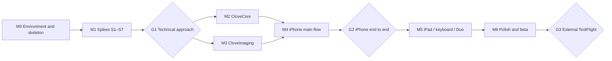

# Clove launch development plan

Status: draft. Based on the [PRD](PRD.en.md) (P0-01 through P0-15). This document breaks the work into tasks with dependencies and acceptance criteria. It does not finalize architecture. Architecture decisions are recorded in `docs/decisions/` after the relevant spikes finish.

## How development works

All development is done by agents. The product owner handles real-device verification, the Apple account and signing, and decisions at each gate. UI visuals are designed by someone else. Engineering implements behavior with system components first and swaps in the visual design when it arrives.

[AGENT-WORKFLOW.md](AGENT-WORKFLOW.md) describes the roles, the issue-to-PR handoff, the worker report format, and who merges what.

### Agent rules

- One task, one issue, one branch, one PR. Issue and PR titles start with the task ID, for example `[C3] XMP codec`.
- Every PR includes tests and merges only after verification passes on the Mac mini: build, unit tests, and simulator smoke test, all run by `mise run verify`. The supervisor re-runs it before merging. There is no hosted CI for launch.
- Stay within the task's scope. Open an issue for anything outside it instead of fixing it in passing.
- A spike's output is a report at `docs/spikes/Sx-name.md` (what was tested, data, conclusion, recommendation) plus reusable verification code. Spikes do not ship product features.
- Where a decision is needed, list the options and a recommendation in the report or PR. The product owner decides at the gate.
- The PRD wins any conflict. If the PRD looks infeasible, raise it in a report. Do not change scope unilaterally.
- `AGENTS.md` at the repository root (produced by T0.2) records code conventions, directory layout, and how to run tests. Every agent reads it before starting.

### Real-device verification

Agents cannot operate physical devices. Tasks marked "Device" follow this loop:

1. The agent builds the verification logic into **Clove Lab**, a debug app that is a separate target in the same repository.
2. The release script on the Mac mini uploads Clove Lab to TestFlight for internal testing, which needs no review.
3. The product owner installs it on the device and follows the task's checklist. Clove Lab writes measurements to a JSON report, saved into the tested folder or sent through the share sheet.
4. The report goes back to the agent for analysis and into the spike report.

Test devices: iPhone 17 Pro Max, iPad Pro, iPhone Duo, an SD card reader, and a USB-C external SSD.

## Prerequisites (done 2026-11-08)

- **Build host.** A Mac mini with Xcode 27.1 and Swift 6.4 is linked to T3 as the agent environment. The repository and worker checkouts live on its T7 external SSD. Details are in [AGENT-WORKFLOW.md](AGENT-WORKFLOW.md#environment).
- **Bundle IDs and app records.** `com.mimiqdev.clove` (Clove) and `com.mimiqdev.clove.lab` (Clove Lab) are registered, each with an App Store provisioning profile and an App Store Connect app record. Clove Lab is used only for internal TestFlight testing, through the `Clove Lab Internal` group.
- **App Store Connect API key and distribution certificate** stay on the Mac mini in `~/.config/apple/`. They are referenced from gitignored local config and never committed or stored in GitHub.

## Technical baseline

- Native iOS and iPadOS app, minimum iOS 18, Swift 6 with strict concurrency checking.
- SwiftUI first. Wrap UIKit where performance or gestures demand it: the grid (`UICollectionView`), focus-check zoom (`UIScrollView`), and the custom swipe-distance rating gesture.
- Generate the Xcode project from an XcodeGen `project.yml`. Do not commit `.xcodeproj`, so parallel agents never conflict in `project.pbxproj`.
- No third-party dependencies by default. Whether to adopt Adobe XMP Toolkit is decided by S3.
- Layers:

| Module | Contents | Depends on |
| --- | --- | --- |
| `CloveCore` (Swift package) | Domain model, scanning and pairing, XMP codec, write queue, undo, Move rejects, grouping algorithm, settings, Recents | Foundation (XMP depends on S3) |
| `CloveImaging` (Swift package) | Preview extraction and caching, full RAW decoding, image feature computation | ImageIO, Core Image, Vision |
| `Clove` (app) | UI, gestures, scene state | Both packages |
| `CloveLabKit` (Swift package) | Topic-named lab probes and report tooling | Foundation, ImageIO, Core Image, Vision |
| `CloveLab` (debug app) | Spike verification and device measurements | `CloveCore`, `CloveImaging`, `CloveLabKit` |

`CloveCore` and `CloveImaging` tests run with `swift test` on macOS without a simulator, which gives agents the fastest iteration loop.

## Milestones

| Milestone | Scope | Exit gate |
| --- | --- | --- |
| M0 | Repository skeleton, test fixtures, TestFlight release | `mise run verify` passes on the Mac mini; Clove Lab installs from TestFlight on a device |
| M1 | Spikes S1–S7 | **G1**: review spike reports and choose the technical approach; revise the PRD if needed |
| M2 | Core engine, `CloveCore` | Unit tests cover the PRD's persistence rules |
| M3 | Imaging pipeline, `CloveImaging` | Grid scrolling and preview speed meet the targets set at G1 on device |
| M4 | iPhone main flow | **G2**: the product owner completes the main path on the 17 Pro Max with a real SD card |
| M5 | iPad, keyboard, Duo | Main path works on Duo and iPad |
| M6 | Failure states, accessibility, performance, beta | **G3**: external TestFlight testing |

M2 and M3 run in parallel. Some M4 UI tasks can start as soon as M2 interfaces are defined, using mock data.

## Dependencies

---

## M0 Environment and skeleton

| ID | Task | Output and acceptance | Depends on | Size | Device |
| --- | --- | --- | --- | --- | --- |
| T0.1 | TestFlight release | `scripts/release-testflight.py` (`mise run release`), adapted from the one in the sibling Mudi app: archive, sign locally with the distribution certificate and the App Store profile, validate, and upload, for either app (`--app clove|lab`). Configuration comes from gitignored `Config/TestFlight.local.json` (or `--config`, or `$CLOVE_TESTFLIGHT_CONFIG`), which points at the signing files in `~/.config/apple/`. Build numbers come from UTC time and must be higher than any build already in TestFlight for that app and version. Upload refuses a dirty working tree. The script confirms that the internal TestFlight group `Clove Lab Internal` (already created, with access to all builds) exists before uploading. Logic-only unit tests for the script (`mise run test-release`), with no network and no signing. How to release: `docs/release.md`. | T0.2 | M | Yes (install once to confirm) |
| T0.2 | Repository skeleton | `project.yml` with App and CloveLab targets (iPhone and iPad, iOS 18); both local packages; `mise.toml` pinning xcodegen with a lockfile, plus tasks `generate`, `test-core`, `test-imaging`, `build`, `smoke`, and `verify` (all of the above); `scripts/generate-xcodeproj.sh` keeping the team ID out of git; build output in the checkout (`.build/DerivedData`); each run uses its own simulator device; swift-format configuration; `AGENTS.md`; complete `.gitignore` | — | M | No |
| T0.3 | Test fixtures | `scripts/fetch-fixtures` downloads RAW files from public sources such as raw.pixls.us (CR3, NEF, ARW, RAF, ORF, RW2, DNG, iPhone ProRAW) plus JPEG and HEIC, with checksums and license records, without committing binaries. Generates standard test folders: multiple `DCIM/100XXXXX` subfolders, RAW+JPG pairs, standalone JPEG/HEIC/DNG, AppleDouble `._` files, an existing `_Rejected` folder, and hand-written Lightroom-, Capture One-, and Photo Mechanic-style XMP including unknown namespaces. Downloads go to a shared cache outside the repository (default `/Volumes/T7/Projects/.clove-fixtures`, overridable with `CLOVE_FIXTURES_DIR`), so parallel checkouts never download twice. | — | M | No |

## M1 Spikes

All depend on T0.2 and T0.3. S0 builds the shared harness; S1–S7 depend on it and can run in parallel. Each ends with a report, collected for G1.

| ID | Question | What to test | Output | Size | Device |
| --- | --- | --- | --- | --- | --- |
| S0 | Spike harness | Clove Lab lists S1–S7; shared folder picker, stopwatch, and JSON report tooling; report written into the tested folder and Documents; fixture sets resolved from the shared cache | Harness for S1–S7; report template and schema in `docs/spikes/README.md` | S | No |
| S1 | Can folder access be remembered and restored reliably? | Pick SD card, external SSD, and local folders; save bookmarks, kill the app, and reopen; record the errors for an unplugged drive, a write-protected card, a full volume, and lost permission; check how quickly a disconnect is detected | Error-to-PRD-copy mapping; bookmark and Recents approach; disconnect detection approach | M | Yes |
| S2 | Are previews fast enough? | Embedded preview extraction time, size, and memory per format; fallback when no embedded preview exists; `CIRAWFilter` full decode time on the 17 Pro Max and iPad Pro | Thumbnail and detail image strategy; cache design; recommended performance targets | M | Yes |
| S3 | How should XMP be read and written? | Compare ImageIO's XMP APIs, Adobe XMP Toolkit, and custom XML parsing: read and write `xmp:Rating`, `xmp:Label`, and the Clove-specific field; round-trip the T0.3 fixtures and check that unknown namespaces and structures survive unchanged; do atomic write-to-temp-and-replace on an exFAT SD card | Decision in `docs/decisions/`; sidecar naming rule | M | Yes (exFAT) |
| S4 | Can metadata be changed without re-encoding? | Write metadata into JPEG, HEIC, and DNG and compare image data before and after | List of formats that support embedded metadata writes | S | No (simulator first, device confirmation) |
| S5 | Is the data needed for grouping available? | Whether each format exposes subsecond capture time, camera model, and serial number; Vision feature computation speed on embedded previews; trial time-gap and similarity thresholds on burst samples | Initial grouping parameters; fallback when subseconds or serial numbers are missing | M | Yes (speed) |
| S6 | How long does scanning take? | Recursive scan of about 2,000 files through a card reader; which prefetched file attributes are fastest | Scan strategy; whether to show results while scanning | S | Yes |
| S7 | How does the system expose Duo fold state? | On the Duo, confirm how the hinge position, fold posture, and window size changes are reported; whether the scene survives switching between cover and inner screens | Duo adaptation approach; required minimum SDK | S | Yes |

**G1**: the product owner reviews all seven reports and decides the XMP approach, preview strategy, performance targets, and Duo approach. If something is infeasible (for example, HEIC cannot take metadata without re-encoding), revise the matching PRD item.

## M2 Core engine (`CloveCore`)

Depends on G1. Ordering follows the Depends on column.

| ID | Task | Output and acceptance | Depends on | Size | PRD |
| --- | --- | --- | --- | --- | --- |
| C1 | Domain model | Photo item (primary file, paired JPG, sidecar), marks (rating, label, Reject), folder session; photo item IDs stay stable across rescans | G1 | S | P0-01, P0-05 |
| C2 | Scanning and pairing | Recursive scan; skip the rejects folder (configurable name), hidden files, and `._` files; pair same-name RAW+JPG in the same folder; detect unsupported files; tested against T0.3 fixtures | C1 | M | P0-01 |
| C3 | XMP codec | Using the S3 approach, read and write ratings, labels (default five and extended colors, fixed English names), the Clove Reject field, and optional Rating −1; preserve unknown content; round-trip tests cover every XMP fixture | C1 | M | P0-07 |
| C4 | Write queue and save state | Serial writes per file; atomic writes; read-back confirmation; per-change state (pending, writing, saved, failed with reason); retry; per-photo batch results; query for unfinished writes | C3 | L | P0-07, P0-08, P0-09 |
| C5 | Undo | Undo for single, batch, and in-group finishing actions; undo goes through the write queue; records which photo to return to | C4 | M | P0-05, P0-12 |
| C6 | Move rejects | Build a move plan first (primary file, paired JPG, XMP; destination preserves subfolders; suffix on name collisions), then execute per photo; same-volume check; retry only failed items; refuse on read-only locations | C2, C4 | M | P0-10 |
| C7 | Embedded metadata writes | Implement for the formats S4 approves; return a clear reason for unsupported formats | C3 | S | P0-07 |
| C8 | Sorting and filtering | Sort by capture time (with subseconds) or filename; photos without capture time sort last; filters All, Unmarked, Rejected, N stars or higher | C1 | S | P0-03 |
| C9 | Grouping algorithm | Split by camera body, cut runs by time gap, split runs by feature distance; two-stage output (time first, then refinement); keep group IDs stable during refinement; cache results per folder; similarity is injected through a protocol so the algorithm can be tested with fake data | C1, C8 | M | P0-11 |
| C10 | In-group culling logic | Undecided count; Keep this, reject the rest and Keep rated, reject the rest, never rejecting photos with a rating or label; group completion; next group, skipping completed groups | C4, C9 | S | P0-12 |
| C11 | Recents | Bookmark storage; path summary, media type, count, last-opened time; distinguish stale bookmarks from missing locations | C1 | S | P0-02 |
| C12 | Settings | Every PRD setting with its default: gestures, enabled ratings, auto-advance and its triggers, double-tap behavior, synchronized zoom, extended colors, Rating −1, embedded writes, rejects folder name, Move rejects on or off, similar groups on or off, grid group display | — | S | Multiple |
| C13 | Rating rules | Swipe distance to rating (dead zone, step distance, mapping only to enabled ratings); keyboard `↑` to the next enabled rating; pure functions with their own tests | C12 | S | P0-06 |

## M3 Imaging pipeline (`CloveImaging`)

Depends on G1. Runs in parallel with M2.

| ID | Task | Output and acceptance | Depends on | Size | Device |
| --- | --- | --- | --- | --- | --- |
| I1 | Thumbnail pipeline | Extract embedded previews per the S2 strategy; memory and disk cache keyed by path, modification time, and size; grid prefetch and cancellation; explicit state when no preview is available | G1 | M | Yes (performance) |
| I2 | Detail preview and 100% | Show the large embedded preview first; decode full RAW on demand when zooming to 100%; cancellable decoding; memory ceiling | I1 | M | Yes |
| I3 | Image features | Vision feature computation in the background at low priority; pausable; cached; provides similarity to C9 | I1 | S | Yes (speed) |
| I4 | Metadata reading | Capture time with subseconds, camera model, and serial number for sorting and grouping | G1 | S | No |

## M4 iPhone main flow

Depends on C-series interfaces (start with mock data). G2 follows when all are done. Use system components for visuals and mark the places the visual design will replace.

| ID | Task | Output and acceptance | Depends on | Size | PRD |
| --- | --- | --- | --- | --- | --- |
| U1 | App skeleton and state | Navigation structure; restorable scene state (current folder, current photo, filters, selection, group-view position) as the base for Duo continuity | C1 | M | P0-13, P0-14 |
| U2 | Entry and Recents | Open folder; Recents list; inline explanation for unavailable locations | C11, U1 | S | P0-01, P0-02 |
| U3 | Grid | Three-column `UICollectionView`; cells show Reject, rating, color dot, and R+J; similar-group outline and tag (expanded and collapsed); filters and sorting; the visible photo does not jump while grouping refines | C8, I1, U1 | L | P0-03, P0-11 |
| U4 | Multi-select and batches | Long-press to multi-select; batch rating, label, and Reject; partial-failure message and retry of failed items only | C4, U3 | M | P0-09 |
| U5 | Detail and focus check | `UIScrollView` zoom; double-tap to 100% around the tapped point; pan while zoomed; edge single taps navigate without waiting for double tap; filmstrip; top marking HUD; rating bar, labels, Reject, and Undo buttons | I2, U1 | L | P0-04 |
| U6 | Swipe-distance rating gesture | Custom gesture recognizer: ladder on swipe up, haptic per step, write on release, cancel by returning to start, swipe down to reject; disabled while zoomed; no conflict with paging; auto-advance with the 0.3-second pause and trigger rules | C13, U5 | M | P0-06 |
| U7 | Save state and recovery | Global status indicator; single-photo retry; copy for all eight failure situations from the S1 mapping; confirmation when leaving with unfinished writes | C4, U5 | M | P0-08 |
| U8 | Undo | System `UndoManager`: toolbar button, three-finger gestures, ⌘Z; return to the affected photo after undo | C5, U5 | S | P0-05 |
| U9 | Group view | Undecided progress bar; synchronized zoom; Undecided only; both finishing actions; advance to the next group on completion | C10, U5 | M | P0-12 |
| U10 | Move rejects | Confirmation sheet (RAW, JPG, and XMP counts and destination); progress; partial failure | C6, U3 | S | P0-10 |
| U11 | Settings screen | All settings | C12 | S | Multiple |

**G2**: on the 17 Pro Max, with a real SD card and external SSD, the product owner completes: open → grid → mark in detail → cull a group → move rejects → quit and reopen with marks intact. The product owner also confirms the gesture feel (step distance and dead zone).

## M5 iPad, keyboard, and Duo

| ID | Task | Output and acceptance | Depends on | Size | Device |
| --- | --- | --- | --- | --- | --- |
| P1 | iPad layout | Sidebar (locations, filters, labels, similar groups); five-column grid; right-hand marking rail in detail; group view with large preview and sidebar grid | G2 | M | Yes |
| P2 | External keyboard | `0`–`5`, `6`–`9`, `↑`, `↓`, `←` `→`, `⌘Z`; only enabled ratings accepted; also works on iPhone with a keyboard | U6, U8 | S | Yes |
| P3 | Duo adaptive layout | Per the S7 approach: compact cover layout; inner screen defaults to grid and detail side by side with the split on the hinge; controls never cross the hinge when half-folded; layout follows available space, not device model | G2, S7 | L | Yes |
| P4 | Duo state continuity | Cover ↔ inner, half-fold, and window resizing preserve folder, photo, filters, selection, group-view position, and write status | U1, P3 | M | Yes |

## M6 Polish and beta

| ID | Task | Output and acceptance | Depends on | Size | Device |
| --- | --- | --- | --- | --- | --- |
| Q1 | Light and dark | All main screens, the group view, and every Duo posture follow system appearance | M5 | S | No |
| Q2 | Accessibility | VoiceOver reads mark state; accessibility actions for rating, Reject, and labels so every mark can be applied without gestures | M5 | M | Yes |
| Q3 | Performance | Grid scrolling, peak memory, scan time, and grouping time on a 2,000-photo folder, against the G1 targets | M5 | M | Yes |
| Q4 | Acceptance automation | Automate what the PRD acceptance table allows (core tests and simulator UI tests); turn the rest into a device checklist | M5 | M | No |
| Q5 | Release prep | Privacy manifest `PrivacyInfo.xcprivacy` (reading file timestamps is a required-reason API); placeholder icon; version and build number rules; external TestFlight materials | M5 | S | No |
| Q6 | Visual design swap | Apply colors, type, icons, and spacing from the delivered design without changing behavior | Design delivery | M | Yes |

**G3**: the device checklist passes in full, and the build goes to external TestFlight testing.

## Parallel lanes

Between gates, these lanes can go to different agents at the same time:

| Phase | Parallel lanes |
| --- | --- |
| M0 | T0.2 skeleton ‖ T0.3 fixtures, then T0.1 TestFlight release |
| M1 | S1 ‖ S2 ‖ S3 ‖ S4 ‖ S5 ‖ S6 ‖ S7 |
| M2+M3 | Write lane (C3 → C4 → C5, C6, C7) ‖ scan lane (C2, C8, C11) ‖ grouping lane (C9 → C10, with I3) ‖ imaging lane (I1 → I2, I4) ‖ rules lane (C12 → C13) |
| M4 | Grid lane (U3 → U4, U10) ‖ detail lane (U5 → U6, U8, U9) ‖ entry and settings (U2, U11) ‖ state lane (U7) |
| M5 | iPad (P1, P2) ‖ Duo (P3 → P4) |

## Risks

| Risk | Impact | Mitigation |
| --- | --- | --- |
| ImageIO drops unknown content when writing XMP | Violates the PRD rule to preserve other apps' data | S3 compares three approaches; adopt XMP Toolkit or custom parsing if needed |
| No atomic writes on exFAT, or an unplugged drive leaves a half-written file | Corrupted marks | S3 verifies write-to-temp-and-replace; C4 confirms by reading back |
| Some RAW files lack a usable embedded preview, or the system does not support the compression | Blank grid cells | S2 lists each format's behavior; the UI shows an explicit cannot-preview state |
| Subsecond capture time or serial number unavailable | Inaccurate burst grouping | S5 defines fallbacks (filename sequence, coarse time grouping) |
| Duo fold-state APIs differ from expectations | P3 rework | S7 confirms on the device early |
| Device verification depends on the product owner's time | Gate delays | Each TestFlight build ships with one clear checklist that covers several tasks at once |

## Out of scope

- UI visual design (handled by someone else; see Q6)
- Interoperability testing with Lightroom and other desktop apps (deferred in the PRD)
- 1.1 candidates (see the PRD)
